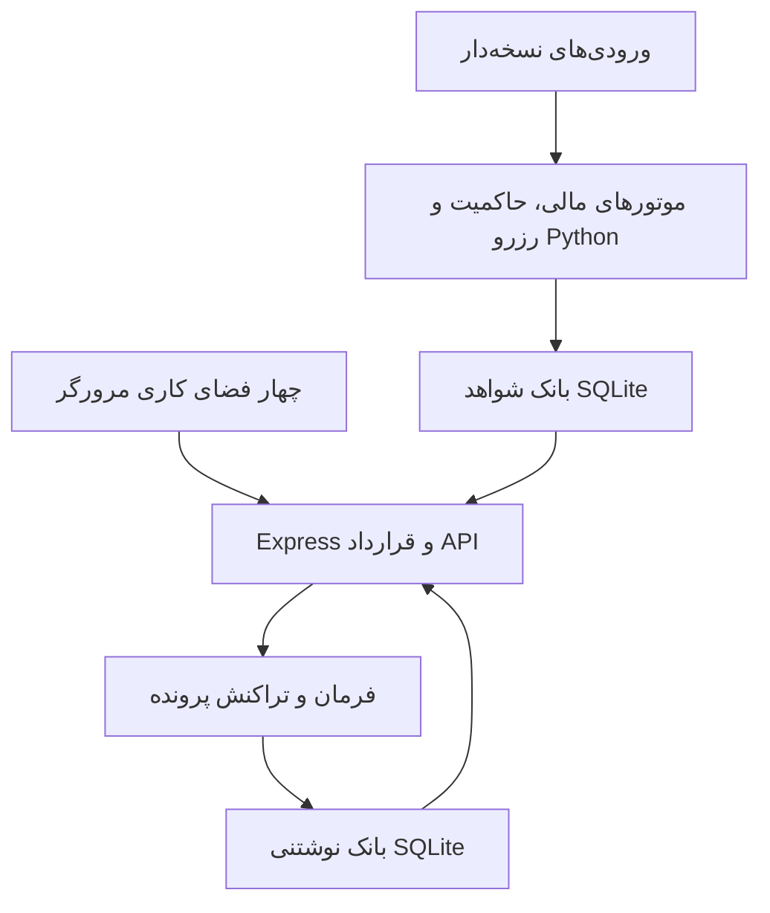

# معماری اجرای محلی

مبنای طراحی `main@a7b6a8a` است. بسته برای اجرای دموی پارس روی یک میزبان طراحی شده است. کاتالوگ، شواهد آموزشی و داده‌های ورودی دو بانک طبق قرارداد `DEV/technical-spec.json` طبقه‌بندی می‌شوند. فرض ظرفیت یا هویت سازمانی از مقادیر آموزشی استخراج نمی‌شود.

## تصمیم‌های معماری

| تصمیم | انتخاب و دلیل | پیامد قابل بررسی |
|---|---|---|
| ADR-01 | اجرای Node.js با Express و SQLite داخلی، و ساخت بانک مرجع با Python 3 طبق وابستگی‌های موجود | ساخت بانک از نسخه مرجع و بازکردن آن در حالت فقط‌خواندنی، آزمون در `scenario-lab/test_build_bank.py` |
| ADR-02 | جداسازی بانک خواندنی با `PVPT_TOTAL_DEMO_DB` از تاریخچه نشست با `PVPT_DATABASE_PATH` | راه‌اندازی مجدد، شناسه پرونده و تاریخچه همان نشست را حفظ می‌کند. آزمون در `tests/total-system.spec.js` |
| ADR-03 | رابط فارسی و انگلیسی چهار نقش با HTTP و دو پوسته، در `demo/total-system/` | مسئولیت نمایش با مرورگر، اعتبار فرمان و تراکنش با سرور. قرارداد داده در `DEV/api-contract.json` |
| ADR-04 | تفکیک زمان، هزینه ساخت، مبلغ وصول و ظرفیت با واحد و منشأ مستقل | `scenario-lab/finance.py` و شواهد `scenario-lab/evidence/executive.json` مرجع بازتولید محاسبات هستند |

## ترتیب تحویل و معیار پذیرش

| Gate | کار موازی و مالک | ورودی | شاهد مورد انتظار |
|---|---|---|---|
| ۰ | معماری و هماهنگ‌کننده | نسخه مبنا، دامنه دمو | تصمیم‌های همین سند و فهرست نسخه مبنا |
| ۱ | معماری، موتور، backend و frontend | Gate ۰ | اعتبارسنجی DEV و قرارداد قابل‌خواندن ماشین |
| ۲ | موتور و backend | Gate ۱ | ساخت بانک، آزمون واحد و API، بررسی خطا و ثبت نسخه |
| ۳ | frontend و QA | قرارداد Gate ۱ و سرویس پذیرفته‌شده Gate ۲ | مشاهده سناریو از دو مسیر، چهار نقش، بازیابی پرونده و آزمون نمایش |
| ۴ | QA و هماهنگ‌کننده | Gates ۲ و ۳ | آزمون کامل سناریو، یکپارچگی و مرورگر و ثبت شکست و بازآزمایی |
| ۵ | هماهنگ‌کننده و QA | Gate ۴ | شروع از دستور مستند، سلامت API، خواندن شمار بانک و عملکرد روی localhost |

آماده‌سازی UI و طراحی آزمون می‌تواند بعد از Gate ۱ همزمان با پیاده‌سازی موتور انجام شود. پذیرش UI به API پذیرفته‌شده وابسته است. شکست هر آزمون به مالک مؤلفه بازمی‌گردد و پس از اصلاح، گیت مربوط و آزمون‌های وابسته تکرار می‌شوند. این جدول معیار است و نتیجه اجرا باید از گزارش نسخه خوانده شود.

## نقشهٔ ردیابی

| الزام | مرز کد | آزمون یا شاهد |
|---|---|---|
| ماندگاری و نسخه‌بندی | `server/workspace-db.js` و `server/total-demo.js` | `tests/mang07-database.spec.js` و `tests/total-system.spec.js` |
| قواعد رزرو و برخورد زمانی | `scenario-lab/reservation.py` و ذخیره‌سازی تراکنشی فضای کار | `scenario-lab/test_reservation.py` و مسیر رزرو آزمون مرورگر |
| منشأ بانک و شمار سناریوها | `scenario-lab/build_bank.py` و `scenario-lab/run.py` | `scenario-lab/test_build_bank.py`، مقایسه summary و executive |
| مسیر مالی و وصول | `scenario-lab/finance.py` و `scenario-lab/executive.py` | بررسی شواهد ثبت‌شده و آزمون executive در `tests/total-system.spec.js` |
| گردش کار و نقش‌ها | `demo/total-system/app.js`، `server/total-demo.js` | `tests/total-system.spec.js` |
| سلامت و استقرار محلی | `server.js`، `package.json` و `.env.example` | اجرای واقعی مطابق گزارش QA نسخه |

فهرست کامل مسیرهای ردیابی‌شده در آغاز کار در `baseline-files.txt` ثبت است. برای نسخه تحویلی، `git ls-tree -r --name-only HEAD` فهرست دقیق را تولید می‌کند. مالک قرارداد مخزن معماری است؛ engine در `scenario-lab/`، سرویس در `server/` و `server.js`، رابط در `demo/`، آزمون در `tests/` و مستندات و شواهد تحویل در `DEV/` قرار می‌گیرند.
