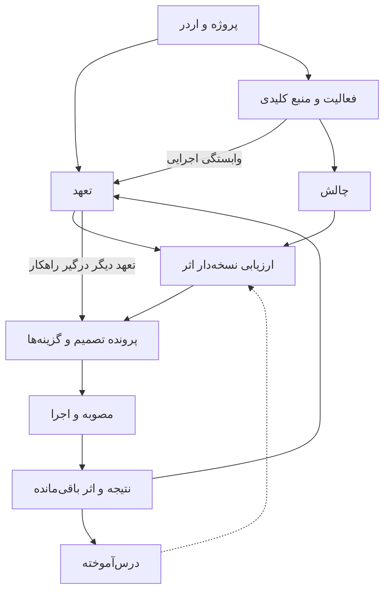

# مدل مفهومی یکپارچه حفاظت از تعهدات و ارزش پروژه‌ها

**پارس ژنراتور مپنا | سند مبنای توسعه دموی MANG_07**

## ۱. هدف و مرز نسخه

دمو برای اثبات منطق محصول نزد مدیرعامل است. با یک سناریوی آموزشی باید نشان دهد که شرکت می‌تواند از تعهد به علت و راهکار برسد، از چالش به همه تعهدات متأثر برسد، و تصمیم و نتیجه را در هر دو مسیر ببیند. اعداد سناریو و شواهد نتیجه با برچسب آموزشی نمایش داده می‌شوند. پایلوت عملیاتی مرحله بعدی و جداگانه است و دامنه داده واقعی، کاربران، اتصال به SAP و استقرار آن باید مستقل تعیین شود.

معیار موفقیت دمو این است که مدیرعامل بتواند با یک مثال توضیح دهد «چرا گزینه‌ای مناسب یک سفارش، برای شرکت انتخاب مناسبی نیست» و بتواند همان استدلال را از هر دو مسیر بازسازی کند.

## ۲. یک مدل، دو نقطه ورود

| نقطه ورود | سؤال | مسیر ردیابی |
|---|---|---|
| **تعهد** | چه عواملی موعد تکمیل، تحویل یا وصول را تهدید می‌کنند و تصمیم‌های ما چقدر مؤثر بوده‌اند؟ | پروژه ← تعهد ← فعالیت و منبع وابسته ← چالش و اثر ← گزینه و تصمیم ← نتیجه و درس |
| **چالش** | این رخداد کدام تعهدات را تغییر می‌دهد و راهکارها روی چه تعهدات دیگری اثر می‌گذارند؟ | چالش ← منبع/فعالیت ← تعهدات متأثر ← گزینه‌ها و آثار جانبی ← تصمیم ← نتیجه و درس |

این دو مسیر، شناسه و تاریخچه مشترک دارند. ورود از یک تعهد، فقط نقطه آغاز و فیلتر نما را تغییر می‌دهد. تصمیم‌گیر برای انتخاب گزینه باید آثار آن بر **تمام تعهدات مرتبط با تصمیم** را ببیند. یک چالش ممکن است چند تعهد را تغییر دهد و یک تعهد ممکن است تحت تأثیر چند چالش باشد. یک گزینه نیز می‌تواند تعهدی را تغییر دهد که در وضعیت بدون اقدام از چالش آسیب نمی‌دید.

## ۳. مفاهیم و روابط داده‌ای

| موجودیت / رابطه | تعریف و اطلاعات لازم |
|---|---|
| **پروژه، سفارش و فعالیت** | دامنه کار و محل ردیابی عملیات. رابطه با تعهد باید صریح باشد. یک مرحله وصول ممکن است به چند سفارش وابسته باشد. |
| **تعهد** | شناسه یکتا، نوع تکمیل/تحویل/وصول، پروژه، مالک، موعد معتبر، نسخه خط مبنا و مقدار یا مبلغ در صورت کاربرد. موعد قراردادی یا داخلی از پیش‌بینی جداست. |
| **وابستگی اجرایی** | رابطه فعالیت/منبع با تعهد. ایستگاه، ماده، تخصص، مجوز یا نوبت مشتری می‌تواند شرط تحقق باشد. رابطه وابستگی صرفاً دلیل بررسی اثر است. |
| **چالش** | رخداد یا انحراف دارای شناسه، منبع یا فعالیت درگیر، ثبت‌کننده، زمان، مالک و شواهد. ثبت اولیه با اثر نامشخص مجاز است. |
| **ارزیابی اثر چالش** | رابطه نسخه‌دار چندبه‌چند بین چالش و تعهد. نوع اثر، مسیر علّی، زمان یا مبلغ، وضعیت احتمالی یا قطعی، دامنه سناریو، مرجع، مسئول تأیید و اعتبار برآورد در آن ثبت می‌شود. |
| **پرونده تصمیم** | دامنه تصمیم، مجموعه آثار، سفارش‌های درگیر، گزینه‌ها و صاحب اختیار. یک چالش مبنای آغاز نسخه دمو است. مدل هدف اجازه می‌دهد تصمیم واحد چند چالش مرتبط را پوشش دهد. |
| **گزینه و اثر گزینه** | هر گزینه به پرونده تعلق دارد و برای هر تعهد درگیر یک برآورد نسخه‌دار دارد. هزینه افزایشی، منابع، قیود، موعد انتخاب و اثر بر سفارش اهداکننده ظرفیت مشخص می‌شوند. عدم اقدام مبنای مقایسه است و می‌تواند به‌عنوان تصمیم صریح با موعد بازبینی ثبت شود. |
| **مصوبه و اجرا** | شناسه تصمیم، نسخه گزینه و قیود، دلیل، تصمیم‌گیر، مالک اجرا و موعد. تصویب، پذیرش مسئول، شروع و پایان رویدادهای جداگانه‌اند. در دمو انتساب نقش و رزرو در حد سناریوی آموزشی نمایش داده می‌شوند. |
| **نتیجه** | برای هر تعهد مشاهده و شواهد جداگانه ثبت می‌شود، همراه اختلاف با پیش‌بینی مصوب، اثر باقی‌مانده و وضعیت تأیید. نتیجه تعهدهای تکمیل، تحویل و وصول می‌تواند در زمان‌های متفاوت برسد. |
| **درس‌آموخته** | به تصمیم و نتیجه پیوند دارد و از هر دو نما قابل بازیابی است. علت، زمینه، شناخت حاصل، شاهد، شرط کاربرد مجدد و مالک بازبینی را نگه می‌دارد. بازیابی درس مشابه به‌عنوان پیشنهاد نمایش داده می‌شود. |

در دمو یک پرونده می‌تواند از یک چالش شروع شود و چند تعهد و گزینه داشته باشد. وابستگی اجرایی، اثر چالش و اثر گزینه سه رابطه متفاوت‌اند. برای سفارش «ب» می‌توان اثر مستقیم چالش را صفرِ بررسی‌شده ثبت کرد و در عین حال اثر منفی گزینه جابه‌جایی نوبت را ثبت کرد.

## ۴. معنی هر عدد و قاعده به‌روزرسانی

برای هر تعهد روی یک مقیاس زمانی مشترک، موعد معتبر، خط مبنای مصوب، پیش‌بینی پیش از رخداد، پیش‌بینی بدون اقدام، پیش‌بینی هر گزینه، پیش‌بینی مصوب، پیش‌بینی جاری و مشاهده را جدا نگه دارید. صفر فقط پس از بررسی و احراز نبود تغییر ثبت می‌شود. تعهد بدون چالش ثبت‌شده، وضعیت پوشش شواهد مستقل دارد. چالش بدون اثر معین با «اثر در دست بررسی» دیده می‌شود.

- **اثر چالش بر موعد** = تاریخ بدون اقدام − تاریخ پیش‌بینی پیش از رخداد.
- **روز بازیافته با گزینه** = تاریخ بدون اقدام − تاریخ با گزینه.
- **فاصله تا موعد تعهد** = تاریخ پیش‌بینی یا واقعی − موعد معتبر. مثبت یعنی دیرتر از موعد. این شاخص حتی اگر اثر چالش تازه صفر باشد ممکن است نامساعد بماند.
- **خطای پیش‌بینی مصوب** = تاریخ مشاهده‌شده − تاریخ مصوب برای همان تعهد.
- بازه مستقل با کمینه مقدار جدید منهای بیشینه مبنا و بیشینه مقدار جدید منهای کمینه مبنا محاسبه می‌شود. در سناریوهای جفت‌شده، اختلاف هر جفت جدا تعیین می‌شود. ورودی ناموجود خروجی نامشخص دارد.
- چند چالش روی یک تعهد به یک پیش‌بینی مشترک در هر سناریو ختم می‌شوند. مثال، دو مانع موازی که هرکدام همان آزمون را پنج روز عقب می‌اندازند، لزوماً ده روز تأخیر ایجاد نمی‌کنند. در دمو پیش‌بینی مشترک از فرض یا ورودی صریح می‌آید.
- تغییر ورودیِ مدل‌شده محاسبه مرتبط را به‌روز می‌کند. تغییر فرضِ مدل‌نشده، مثل مدت توقف بدون رابطه تقویمی، برآورد را «نیازمند بازبینی» می‌کند. پس از ثبت شاهد نتیجه، وضعیت و پیش‌بینی جاری اصلاح می‌شوند و نسخه مصوب برای مقایسه تاریخی حفظ می‌شود.

**حسابداری و ارزش.** برای تحلیل کارایی هزینه، هزینه واقعی AC از اسناد منتسب به دامنه و تاریخ یکسان با EV می‌آید. EV، ارزش بودجه‌ای کار تأییدشده است و CPI از EV تقسیم بر AC به دست می‌آید. داشبورد EVM کنار نماهای ریسک قرار می‌گیرد و انحراف آن می‌تواند سرنخ ثبت چالش باشد. در دمو، سنجه‌های نمونه فقط با منشأ و برچسب آموزشی نمایش داده شوند. تصویب گزینه، پیش‌بینی را تغییر می‌دهد. داده مشاهده‌شده یا ثبت مالی آموزشی مبنای تغییر واقعیت است.

**ارزش مداخله.** تفاوت هزینه تکمیل با و بدون اقدام، منفعت زمان وصول و هزینه اقدام اجزای قابل ردیابی‌اند. اگر هزینه اقدام در برآورد تکمیل منظور شده است، دوباره کسر نمی‌شود. منفعت زمانی تنها با شرط پرداخت معتبر یا فرض آموزشی صریح، مبلغ مرحله، نرخ و تعداد روز بازیافته محاسبه می‌شود. اصل طلب، مبلغ در معرض تأخیر، منفعت زمان وصول و دریافت واقعی مقادیر مستقل‌اند. واحد تجمیع مالی «رخداد/مرحله وصول + سناریو + دوره و ارز» است، حتی اگر چند چالش یا اردر به آن وصل باشند. مجموع موارد عدددار با پوشش و مجهولات همراه است. منافع گزینه‌های جایگزین با هم جمع نمی‌شوند.

## ۵. گردش کار و وضعیت‌های مستقل

۱. **کارشناس:** رخداد و شاهد را ثبت می‌کند. اگر از تعهد آمده باشد، پیشنهاد پیوند همان تعهد را می‌بیند و آن را بررسی می‌کند.
۲. **مدیر حوزه و کنترل پروژه:** وابستگی و اثر را بررسی می‌کنند. برای هر گزینه پیش‌بینی، قید، مهلت و اثر جانبی ثبت می‌شود. مالی مبنای هزینه و وصول را در سناریو بررسی می‌کند.
۳. **صاحب اختیارِ نمایشی:** گزینه شدنی یا عدم اقدام را به همراه علت و بازبینی تصویب می‌کند. در صورت نبود گزینه شدنی، تصمیم موردنیاز مانند تغییر اولویت یا مذاکره درباره تعهد نمایش داده می‌شود.
۴. **مالک اجرا و بررسی‌کننده نتیجه:** اجرای گزینه، شواهد، تحقق هر تعهد و اثر مالی را ثبت یا تأیید می‌کنند.
۵. **مالک درس:** اختلاف برآورد و نتیجه را به یک قاعده قابل استفاده در شرایط مشابه تبدیل می‌کند و به پرونده اصلی ارجاع می‌دهد.

وضعیت هر محور مستقل است: **تعهد** در مسیر/در معرض خطر/نقض/محقق/نامشخص؛ **چالش** باز/در بررسی/حل‌شده؛ **برآورد** نامشخص/معتبر/نیازمند بازبینی؛ **راهکار** پیشنهادی/مصوب/در اجرا/پایان اجرا/متوقف؛ **نتیجه** در انتظار شاهد/تأییدشده/ردشده. پایان اجرای راهکار می‌تواند با نقض موعد، انتظار وصول یا نتیجه مالی تأییدنشده هم‌زمان باشد. اعتبار و زمان انقضای هر گزینه و تمایز «فرصت امروز» با «فرصت از دست رفته» باید در نما قابل تشخیص باشد.

هر رویداد مهم الزاماً به پرونده تبدیل نمی‌شود. تأیید تحویل، اعلام وصول یا اصلاح موعد مشتری می‌تواند با شاهد معتبر مستقیماً وضعیت تعهد و تحولات را به‌روز کند. چالش وقتی ثبت می‌شود که مانع یا انحراف نیازمند بررسی باشد.

## ۶. نمایش در سیستم

| صفحه یا نما | نقش در نمایش مفهوم |
|---|---|
| **پروژه و تعهدات** | مسیر تعهد‌محور. موعد و پیش‌بینی، مسیر فعالیت و منبع، چالش‌های مرتبط، اثر هم‌پوشان، گزینه‌ها، نتیجه و درس. |
| **چالش‌ها و منابع کلیدی** | مسیر چالش‌محور. منبع درگیر، فهرست تعهدهای مستقیم، آثار نامشخص، تعهدهای متأثر از گزینه و پیوند به همان پرونده تصمیم. |
| **پرونده مشترک تصمیم** | قیود، مقایسه بدون اقدام و گزینه‌ها، اثر روی سفارش‌های دیگر، مصوبه، اجرا و نتیجه. همان شناسه از هر دو مسیر. |
| **نقشه ارزش و ریسک** | نمای جاری اثر بر تعهد و فوریت تصمیم. امکان حرکت به تعهد، چالش یا پرونده. پیش‌بینی مصوب در کنار وضعیت جاری و شواهد نتیجه دیده می‌شود. |
| **پیشرفت فیزیکی و هزینه‌ای** | دو نمای هم‌دامنه پروژه/سفارش/WBS با تاریخ گزارش مشترک. انحراف از اینجا قابل ردیابی به عملیات و پرونده مرتبط است. |
| **دانش و تجربه** | جست‌وجوی درس با علت، نوع تعهد، منبع یا شرایط مشابه و بازگشت به نتیجه اصلی. |
| **صفحه اول مدیرعامل** | هفت خلاصه مصوب در طراحی صفحه شامل کارت مداخله، پیشرفت فیزیکی، پیشرفت هزینه‌ای، نقشه ارزش و ریسک، چالش‌ها، راهکارها و تحولات. زیر هر شاخص، صفحه مقصد و منشأ داده مشخص است. قرارداد جدید تغییر Main Page باید محدوده هر تغییر را جداگانه تصریح کند. |

## ۷. سناریوی مرجع ارائه و معیار پذیرش

**سناریوی آموزشی توقف ایستگاه آزمون مشترک** از نمونه مصوب و گزارش صحه‌گذاری مخزن استفاده می‌کند. ارقام از همان مثال‌اند و وضعیت شرکت را گزارش نمی‌کنند.

1. **ورود از تعهد الف:** موعد تحویل روز ۱۳ است. توقف ایستگاه در پیش‌بینی بدون اقدام آن را به روز ۱۶ می‌برد. از نمای تعهد به چالش و پرونده بروید.
2. **ورود از چالش:** همان پرونده و همان تعهد الف را باز کنید. موعد تحویل ب روز ۱۴ است و در وضعیت بدون اقدام بر اثر این رخداد جابه‌جا نمی‌شود. شناسه‌های مشترک و تاریخچه در هر دو ورودی قابل مشاهده باشند.
3. **مقایسه:** جابه‌جایی نوبت الف را به روز ۱۳ برمی‌گرداند، ولی تحویل ب را به روز ۱۸ می‌برد. گزینه با وجود خالص برآوردی ۴۹۷٫۹۵ میلیون تومان برای اقلام عدددار، به‌علت نقض موعد ب مسدود شود. آزمون بیرونی با ۹۷٫۹۵ میلیون تومان خالص برآوردی و فرض‌های آموزشی صریح، موعد هر دو را حفظ می‌کند. وصول ب نامشخص بماند.
4. **مصوبه و مشاهده:** آزمون بیرونی را در دمو تصویب کنید. پیش‌بینی مصوب تحویل الف روز ۱۳ باشد. سپس تحویل شبیه‌سازی‌شده در روز ۱۴ ثبت شود. هر دو مسیر روز ۱۴، اختلاف یک‌روزه و وضعیت باقی‌مانده را نشان دهند. نسخه روز ۱۳ در سابقه بماند.
5. **درس‌آموخته:** با نتیجه روز ۱۴، درس «پیش‌بینی تحویل پس از آزمون بیرونی باید زمان پذیرش و بازگشت را صریح لحاظ کند» به‌عنوان گزاره آموزشی قابل بررسی ثبت شود. درس از چالش، تعهد الف و پرونده قابل دسترسی باشد.
6. **حالت‌های مرزی:** تغییر مدت توقفِ بدون رابطه مدل‌شده موجب بازبینی شود. حذف شاهد شرط پرداخت، وصول و منفعت زمانی مربوط را نامشخص کند. اثر دو ردیف وابسته به یک مرحله وصول یک‌بار محاسبه شود. در حالت بدون چالش ثبت‌شده، فقدان شاهد آمادگی به‌صورت وضعیت نامشخص دیده شود. نمونه فقط در جریان نمایشی/آزمون مجزا عرضه و بازنشانی شود.

## ۸. توالی پیشنهادی توسعه دمو

| گام | خروجی قابل مشاهده و معیار عبور |
|---|---|
| **۱. هویت مشترک** | شناسه تعهد و رابطه نسخه‌دار اثر به پرونده‌های فعلی متصل شوند. ورود از تعهد و چالش به همان شناسه برسد و رکورد تکراری تولید نشود. |
| **۲. مقایسه گزینه در سطح چند تعهد** | اثر مستقیم و اثر جانبی گزینه جدا نمایش داده شوند. سفارش ب در مقایسه ظاهر شود و قید موعد، جابه‌جایی را مسدود کند. |
| **۳. نتیجه و یادگیری** | پیش‌بینی مصوب، نتیجه و درس از هر دو سمت دیده شوند. ثبت نتیجه، نمای جاری و ریسک باقی‌مانده را به‌روز کند. |
| **۴. روایت مدیرعامل** | مسیرهای ورود با سناریوی آموزشی ثابت نمایش داده شوند. پس از تعیین دامنه مجاز صفحه اصلی، کارت و خلاصه‌های دمو به همین شناسه‌ها و نماها وصل شوند. |

برای کم‌کردن تغییرات، ابتدا از کاتالوگ، تعهدات، پرونده‌های موجود و شناسه‌های پایدار یک نمای ارتباطی مشترک ساخته شود. هر دو مسیر همین نما را بخوانند و عملیات ثبت به همان پرونده و تاریخچه موجود برسد. عنوان، نام محصول و متن شرح کلید اتصال نیستند. تبدیل SQLite به معماری دیگر برای نمایش این منطق پیش‌نیاز نیست.

در پایان ارائه می‌توان یک موقعیت آموزشی دوم باز کرد تا مدیر درس آزمون بیرونی را فقط پس از بررسی صلاحیت آزمایشگاه و پذیرش مشتری به کار ببرد. قبول یا رد این درس و اثر آن بر برآورد بعدی نسخه‌دار ثبت شود.

این سند مدل هدف را تعریف می‌کند. MANG_07 فعلاً گردش کار چالش‌محور، ردیف اثر دارای شناسه تعهد، مقایسه گزینه، ذخیره دمو و سابقه تصمیم و نتیجه دارد. مسیر تعهد‌محور هم‌ارز، تصویر جاری مشترک و قواعد تجمیع بین پرونده‌ها الزامات توسعه بعدی‌اند. منابع مبنا:

- [نسخه بررسی‌شده MANG_07](https://github.com/mtaghipourpars-dotcom/MANG_07/tree/3b3d2919b7429fe394fbb6671dbad2592457652f)
- [قرارداد پیاده‌سازی و محاسبات](https://github.com/mtaghipourpars-dotcom/MANG_07/blob/main/docs/07_MANG_07/IMPLEMENTATION.md)
- [روابط و معماری دموی ذخیره‌شونده](https://github.com/mtaghipourpars-dotcom/MANG_07/blob/main/docs/07_MANG_07/DATABASE-RELATIONS.md)
- [سناریوی صحه‌گذاری آموزشی](https://github.com/mtaghipourpars-dotcom/MANG_07/blob/main/docs/07_MANG_07/VALIDATION.md)
